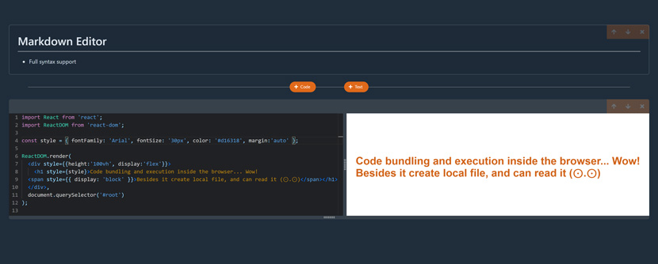

# Code Notebook

A browser-based notebook for JavaScript and React — somewhere between a scratchpad and a lightweight Jupyter. You mix Markdown notes with runnable code cells in one file, saved locally as `notebook.js`.



Originally built as a learning project (Stephen Grider's course) and later updated to a modern stack: React 19, Vite, Redux Toolkit, with esbuild running entirely in the browser.

## How it works

The notebook is made of **cells**:

- **Text** — Markdown documentation; click to edit
- **Code** — JavaScript/JSX with Monaco on the left and a live preview on the right

Code runs in a sandboxed iframe. To see output, call `show(<Component />)`. Variables from earlier code cells carry over to later ones, similar to Jupyter.

You can `import` npm packages (e.g. `axios`) — they're fetched from unpkg and bundled client-side with esbuild-wasm.

On first launch you get a short welcome guide; the full reference is under **Help** in the header.

## Features

- [esbuild-wasm](https://esbuild.github.io/) — transpile and bundle code in the browser
- Custom esbuild plugins for loading npm packages from [unpkg.com](https://unpkg.com)
- [Monaco Editor](https://www.npmjs.com/package/@monaco-editor/react) for code cells
- [Prettier](https://www.npmjs.com/package/prettier) formatting
- [Markdown editor](https://www.npmjs.com/package/@uiw/react-md-editor) for text cells
- [Bulmaswatch Superhero](https://jenil.github.io/bulmaswatch/superhero/) theme
- [Redux Toolkit](https://redux-toolkit.js.org/) for state management
- npm workspaces monorepo (`local-client`, `local-api`, `cli`)

## Tech stack

React 19 · Vite · Redux Toolkit · TypeScript 5 · Express

## Requirements

- Node.js 20+

## Getting started

1. Install dependencies

   ```bash
   npm install
   ```

2. Run the app

   ```bash
   npm run start
   ```

   This starts:
   - Vite dev server on [localhost:5173](http://localhost:5173)
   - Express API + proxy on [localhost:4005](http://localhost:4005)

3. Open [localhost:4005](http://localhost:4005/) to use the notebook

## Production build

```bash
npm run build -w local-client
NODE_ENV=production node packages/cli/dist/index.js serve
```
